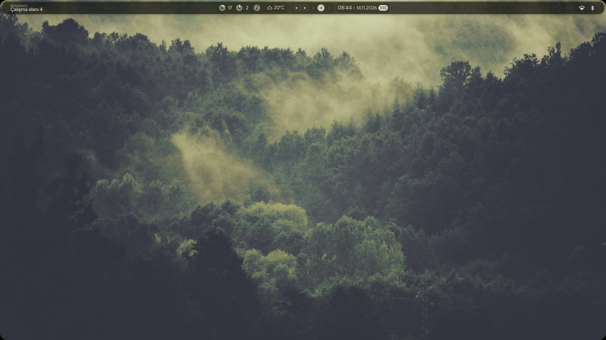
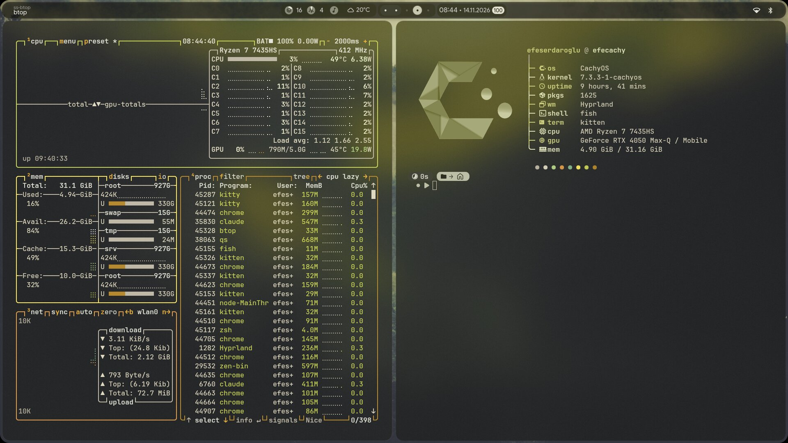
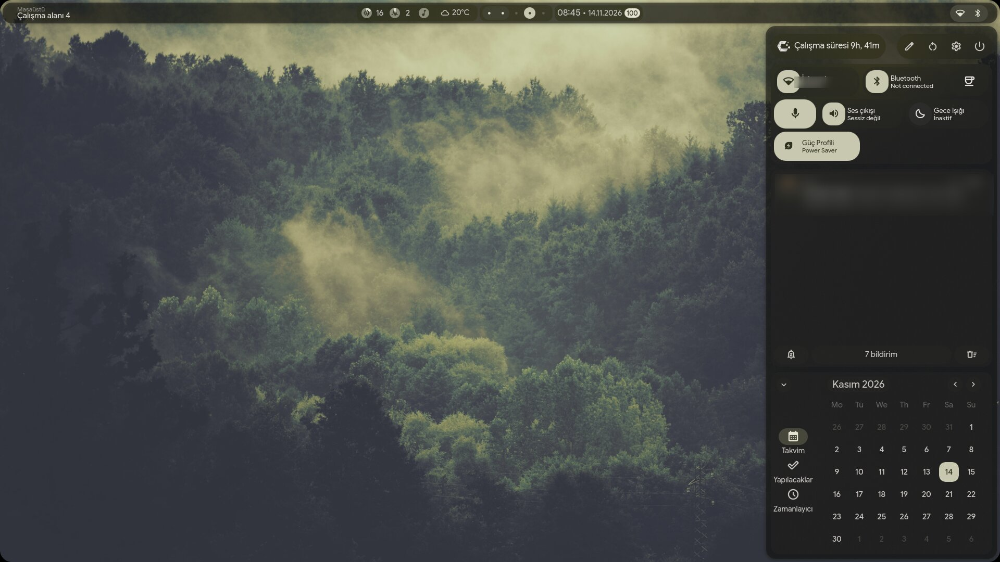
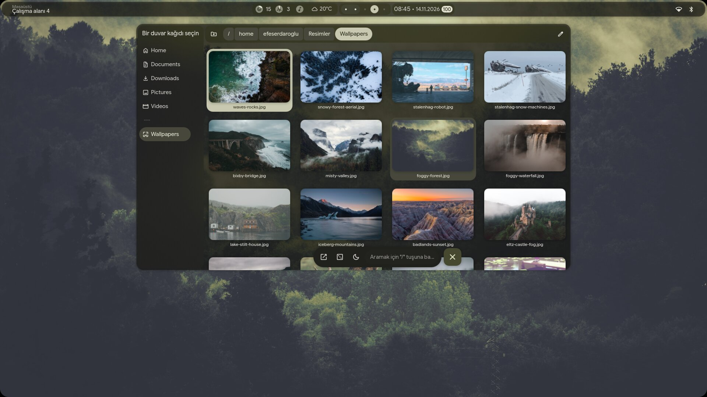

# TNFX-Dotfiles

My Hyprland setup on CachyOS: [end-4/dots-hyprland](https://github.com/end-4/dots-hyprland) (illogical-impulse, Quickshell) plus my own overrides. The whole desktop, and the apps on it, take their colors from the wallpaper.



| | |
|---|---|
|  |  |
| fastfetch + btop in see-through kitty | Quick settings, notifications, calendar |
|  | |
| Wallpaper picker: pick one and everything recolors | |

- **Laptop:** ASUS TUF Gaming A15 (Ryzen 7 7435HS, RTX 4050, NVIDIA only), 1920x1080 @ 144 Hz
- **Base:** end-4 dots, Hyprland 0.57 (Lua config)
- **Terminal:** kitty, see-through with blur · **Shell:** fish · **Cursor:** Breeze_Light

## Highlights

- **One theme everywhere.** Changing the wallpaper recolors the shell, kitty, btop, cava, fastfetch, GTK/Qt, Zen, Discord, Spotify and Steam.
- **Same transparency everywhere.** Everything is about 60% opaque, like the bar. Steam and Spotify can't be truly see-through, so they get a fake blur: a blurred copy of the wallpaper drawn behind their panels.
- **Minimal floating bar** with 5 workspace dots, the date next to the clock and the weather on the left.
- **Sleep that works on NVIDIA.** The screen comes back after waking, and on the charger the screen never turns off and the laptop never sleeps.
- **Power profile on Fn+F5** (the ASUS fan key) with an animated OSD, like KDE's, shown instantly.

## What's in here

| Path | What |
|---|---|
| `.config/hypr/custom/` | My overrides; end-4 never overwrites this folder |
| `custom/general.lua` | 144 Hz panel, Turkish keyboard, mouse speed, saturation shader |
| `custom/rules.lua` | Blur behind kitty and other see-through windows |
| `custom/execs.lua` | Cursor, starts `profile_sync.py` |
| `custom/keybinds.lua` | Super+Alt+P display mode menu |
| `custom/env.lua` | NVIDIA env vars |
| `custom/shaders/saturation.frag` | Screen saturation (`SATURATION`, 1.0 = stock) |
| `custom/scripts/profile_sync.py` | Fn+F5 changes the profile in the kernel; this tells power-profiles-daemon at once so the OSD doesn't lag 2 s (started from `custom/execs.lua`) |
| `.config/hypr/hypridle.conf` | Lock at 5 min; screen off at 10 and sleep at 15, but **not on the charger**; screen back on after waking |
| `.config/illogical-impulse/config.json` | Shell settings: transparency, minimal bar, date `dd.MM.yyyy`, weather city, no AI/anime sidebar tabs |
| `.config/quickshell/ii/modules/ii/bar/` | Patched: resources group no longer overflows onto the workspaces; date next to the clock, weather left of the workspaces |
| `.config/quickshell/ii/modules/common/Appearance.qml` | Patched: wider center bar groups (140 → 230 px) |
| `.config/quickshell/ii/modules/ii/onScreenDisplay/` | Patched: animated power-mode OSD |
| `.config/quickshell/ii/modules/ii/lock/Lock.qml` | Patched: if the shell restarts (Ctrl+Super+R) while locked, jump back from the temporary lock workspace (the 10-digit one) to the real one |
| `.config/quickshell/ii/scripts/colors/switchwall.sh` | Runs the extra theming steps after a wallpaper change |
| `.config/quickshell/ii/scripts/colors/local/fakeblur_css.py` | Fake-blur CSS for Steam (Millennium QuickCSS) and Spotify (Spicetify) |
| `.config/matugen/` | Color templates: Discord, Zen `userChrome.css`, Spicetify, cava, GTK, KDE |
| `.config/kitty/kitty.conf` | `background_opacity 0.6`, cursor trail on every keystroke |
| `.config/btop/`, `.config/darklyrc`, `.config/kcmfonts` | btop on the terminal colors; see-through Qt apps; 1.15x font scale |
| `.config/fastfetch/` | "TNFX Nord" fastfetch layout + logo, colored by the theme |
| `.config/fish/functions/dot.fish` | `dot` = git for this repo (`dot status`, `dot add`, ...) |
| `.local/share/applications/discord.desktop` | Discord at 1.10 scale |
| `Resimler/Wallpapers/` | Wallpapers (credits below); `Resimler` is the Turkish XDG Pictures folder |

## Install

1. Install end-4's dots: `git clone https://github.com/end-4/dots-hyprland && cd dots-hyprland && ./setup install`
2. Put these files on top:
   ```sh
   git clone --bare https://github.com/TNFX1/TNFX-Dotfiles ~/.dotfiles
   git --git-dir=$HOME/.dotfiles --work-tree=$HOME checkout -f
   git --git-dir=$HOME/.dotfiles config status.showUntrackedFiles no
   ```
3. Log in with the plain **Hyprland** session (not UWSM).

`checkout -f` overwrites the files listed above. Back up your own copies first.

Optional, for the app theming: [Spicetify](https://spicetify.app) for Spotify, [Millennium](https://steambrew.app) (`millennium-git`) for Steam, and [Vencord](https://vencord.dev) for Discord (theme lands in `~/.config/Vencord/themes/`).

Updating end-4's dots can overwrite the patched files outside `custom/`. Run `dot status` afterwards and `dot checkout -- <file>` to put them back.

## Wallpaper credits

Wallpapers belong to their artists. Sources:
- [dharmx/walls](https://github.com/dharmx/walls) (`nord-*`, `anime-*`, nature set)
- [D3Ext/aesthetic-wallpapers](https://github.com/D3Ext/aesthetic-wallpapers) (`cyberpunk_car`, `dark_skulls`, `rad_samurai`, `vader`, `neon-car2`, `oled-mountains`, `rm-rf`)
- [wallhaven.cc](https://wallhaven.cc) (the rest)

If you made one of these and want it removed or credited, open an issue.
