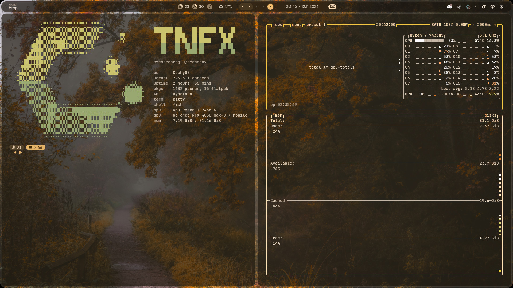

# TNFX-Dotfiles



My Hyprland setup on CachyOS: [end-4/dots-hyprland](https://github.com/end-4/dots-hyprland) (illogical-impulse, Quickshell) plus my own overrides.

- **Laptop:** ASUS TUF Gaming A15 (RTX 4050, NVIDIA-only), 1920x1080 @ 144 Hz
- **Base:** end-4 dots, Hyprland 0.57 (Lua config)
- **Terminal:** kitty, see-through with blur · **Shell:** fish
- **Cursor:** Breeze_Light

## What's in here

| Path | What |
|---|---|
| `.config/hypr/custom/` | My overrides; end-4 never overwrites this folder |
| `custom/general.lua` | 144 Hz panel, Turkish keyboard, mouse speed, saturation shader |
| `custom/rules.lua` | Blur behind kitty |
| `custom/execs.lua` | Cursor |
| `custom/keybinds.lua` | Fn+F4 cycles the power profile |
| `custom/env.lua` | NVIDIA env vars |
| `custom/shaders/saturation.frag` | Screen saturation (`SATURATION`, 1.0 = stock) |
| `custom/scripts/cycle_power_profile.sh` | power-saver → balanced → performance |
| `.config/illogical-impulse/config.json` | Shell settings: transparency, minimal bar, date `dd.MM.yyyy`, weather city, no AI/anime sidebar tabs, night light off |
| `.config/quickshell/ii/modules/ii/bar/Resources.qml` | Patched: stops the resources group overflowing onto the workspaces |
| `.config/quickshell/ii/modules/ii/bar/BarContent.qml` | Patched: date always next to the clock, weather moved to the left of the workspaces |
| `.config/quickshell/ii/modules/common/Appearance.qml` | Patched: wider center bar groups (140 → 230 px) |
| `.config/quickshell/ii/modules/ii/onScreenDisplay/` | Patched: animated power-mode OSD, like KDE's |
| `.config/kitty/kitty.conf` | `background_opacity 0.7`, cursor trail on every keystroke |
| `.config/fastfetch/` | "TNFX Nord" fastfetch layout + logo |
| `Resimler/Wallpapers/` | Wallpapers (credits below); `Resimler` is the Turkish XDG Pictures folder |

## Install

1. Install end-4's dots: `git clone https://github.com/end-4/dots-hyprland && cd dots-hyprland && ./setup install`
2. Put these files on top:
   ```sh
   git clone --bare https://github.com/TNFX1/TNFX-Dotfiles ~/.dotfiles
   git --git-dir=$HOME/.dotfiles --work-tree=$HOME checkout -f
   git --git-dir=$HOME/.dotfiles config status.showUntrackedFiles no
   ```
3. Log in with the plain **Hyprland** session (not UWSM).

`checkout -f` overwrites the files listed above. Back up your own copies first.

## Wallpaper credits

Wallpapers belong to their artists. Sources:
- [dharmx/walls](https://github.com/dharmx/walls) (`nord-*`, `anime-*`)
- [D3Ext/aesthetic-wallpapers](https://github.com/D3Ext/aesthetic-wallpapers) (`cyberpunk_car`, `dark_skulls`, `rad_samurai`, `vader`, `neon-car2`, `oled-mountains`, `rm-rf`)
- [wallhaven.cc](https://wallhaven.cc) (the rest)

If you made one of these and want it removed or credited, open an issue.
